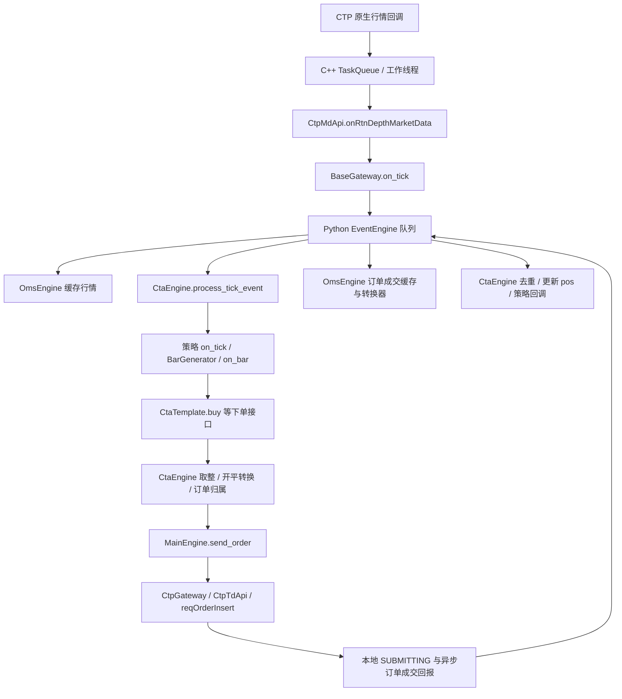

# VeighNa：从行情到成交的跨模块链路

这张调用图对应 S002/S003/S004 固定提交的典型 tick 驱动 CTA 路径；源码定位见下面的表。初始化、重连、拒单和错误处理另有分支。

图中未画独立风险管理 App；本次三个仓库的主链并未自动包含该额外应用。

## 逐站源码与要点

| 站点 | 固定快照中的定位 | 需要区分 |
| --- | --- | --- |
| 原生行情桥 | [vnctpmd.cpp](../../raw/sources/vnpy_ctp/vnpy_ctp/api/vnctp/vnctpmd/vnctpmd.cpp)：OnRtnDepthMarketData / processTask / processRtnDepthMarketData | 原生 TaskQueue 与 Python 事件队列 |
| 行情转换 | [ctp_gateway.py](../../raw/sources/vnpy_ctp/vnpy_ctp/gateway/ctp_gateway.py)：CtpMdApi.onRtnDepthMarketData | 原生字段、合约缓存、日期与 TickData |
| 事件发布/分发 | [gateway.py](../../raw/sources/vnpy/vnpy/trader/gateway.py)：on_tick；[event/engine.py](../../raw/sources/vnpy/vnpy/event/engine.py)：_run/_process | 通用事件与特定合约事件 |
| 订阅与策略调度 | [CTA engine.py](../../raw/sources/vnpy_ctastrategy/vnpy_ctastrategy/engine.py)：_init_strategy / process_tick_event | 已初始化可以接行情；trading 决定能否发新单 |
| 信号与意图 | [double_ma_strategy.py](../../raw/sources/vnpy_ctastrategy/vnpy_ctastrategy/strategies/double_ma_strategy.py)：on_tick/on_bar；[template.py](../../raw/sources/vnpy_ctastrategy/vnpy_ctastrategy/template.py)：buy/send_order | 信号、开平请求与实际成交 |
| 转换与发送 | [CTA engine.py](../../raw/sources/vnpy_ctastrategy/vnpy_ctastrategy/engine.py)：send_order/send_server_order；[converter.py](../../raw/sources/vnpy/vnpy/trader/converter.py)：convert_order_request | 价格/数量取整、今昨仓拆分与完整风控 |
| 交易接口 | [核心 engine.py](../../raw/sources/vnpy/vnpy/trader/engine.py)：MainEngine.send_order；[ctp_gateway.py](../../raw/sources/vnpy_ctp/vnpy_ctp/gateway/ctp_gateway.py)：CtpTdApi.send_order | 请求成功发送、柜台接受和最终成交 |
| 回报与持仓 | 同 CTP 文件：onRtnOrder/onRtnTrade；同 CTA 文件：process_order_event/process_trade_event | 订单状态、每笔成交与策略净 pos |

## 手工追踪一笔 buy

假设策略已启动、合约可用，调用 `buy(price, volume)`。模板先将它转为 LONG/OPEN；CTA engine 取整并生成请求，开平转换后逐笔交 MainEngine 路由到 CTP。CTP 本地 API 接受发送后，先入队 SUBMITTING 并返回 `CTP.FrontID_SessionID_OrderRef`。

订单编号用于建立策略归属，后续 NOTTRADED/PARTTRADED/ALLTRADED 等回报更新活跃订单集合。实际成交回报包含 TradeID，CTA 去重后按成交量增加 pos，再调用 on_trade；资金、账户分方向持仓等由对应事件与查询路径更新。

这只是按源码串联的解释，没有执行真实下单。不能从返回非空编号推断买入已经完成，也不能从保存 pos 推断外部账户已对账。

## 初始化顺序的学习检查点

`MainEngine.add_gateway(CtpGateway)` 与 `add_app(CtaStrategyApp)` 挂载组件；随后需要 CTA 的 `init_engine`、网关连接和合约就绪，再添加/初始化/启动策略。`add_app` 自身不负责初始化 CTA 全部业务；`CtaEngine` 构造时还会加载数据库/数据服务对象。

这是阅读时应检查的依赖顺序，不是本次已执行的启动步骤。运行前另行准备隔离环境与数据库驱动。

相关页面：[vnpy](../modules/vnpy.md) · [CTP](../modules/vnpy-ctp.md) · [CTA](../modules/vnpy-ctastrategy.md) · [实盘与回测](cta-live-vs-backtest.md)
