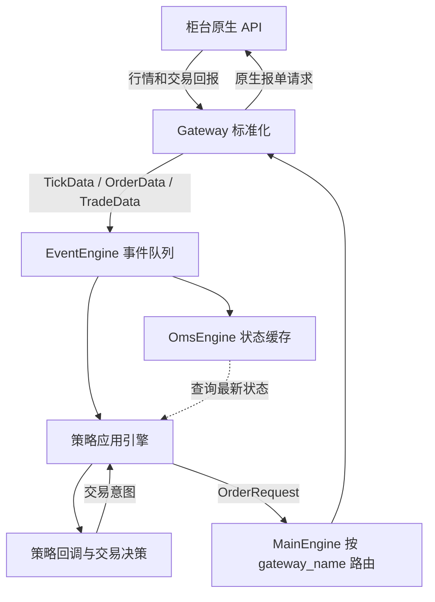

# 从 CTP Demo 到 VeighNa：接口、引擎与策略应用

你的 Demo 已把行情、判断、委托与回报连接起来。下一阶段要理解的是：这些责任如何分开，才能支持更多接口、更多策略以及状态管理。

本文基于本地固定快照：vnpy 4.5.0、vnpy_ctp 6.7.11.5、vnpy_ctastrategy 1.5.0。核心/CTP/CTA 对照源码；投组与价差部分依据 S002 中的官方文档，尚未读取两个独立应用仓库源码。reviewed 表示文字已对照指定资料，不表示完整平台运行验收。以下例子用于解释系统结构，不是交易建议。

## 一张完整链路图

向上主要是异步事件，向下通常是方法调用。`MainEngine.send_order()` 并非先把指令投入事件队列，也不负责撮合。依据：[MainEngine](../../raw/sources/vnpy/vnpy/trader/engine.py) 的 send_order；[跨模块链路](../concepts/veighna-event-flow.md)。

## 1. 底层接口：把不同柜台变成统一接口

### 数据结构标准化

| 你的 CTP Demo | VeighNa 对象/字段 | 用途 |
| --- | --- | --- |
| InstrumentID + 交易所 | symbol、exchange、vt_symbol | `m2701.DCE` 唯一标识合约，不指定交易账户 |
| LastPrice、AskPrice1 | TickData.last_price、ask_price_1 | 行情使用统一字段 |
| 报单字典 | OrderRequest | 统一表达价格、数量、方向、开平、类型 |
| 委托状态回调 | OrderData | 查询已成交量、当前状态、是否仍活跃 |
| 成交回调 | TradeData | 一笔具体成交；一笔委托可以产生多笔成交 |
| 持仓/资金/合约查询 | PositionData / AccountData / ContractData | 分别描述账户持仓、资金和合约规格 |

Gateway 负责翻译字段、枚举和标识，上层无需直接认识 CTP 的字符常量。`vt_orderid` 带有 gateway_name 前缀，避免不同网关订单编号混淆。统一对象不代表各市场交易规则完全相同。

阅读：[object.py](../../raw/sources/vnpy/vnpy/trader/object.py)、[constant.py](../../raw/sources/vnpy/vnpy/trader/constant.py)；[ctp_gateway.py](../../raw/sources/vnpy_ctp/vnpy_ctp/gateway/ctp_gateway.py) 的 onRtnDepthMarketData/onRtnOrder/onRtnTrade。

### 业务流程标准化

上层调用 `connect / subscribe / send_order / cancel_order / query_position / query_account`；Gateway 内部处理柜台特有的认证、登录、结算确认、查询与协议转换，通过 `on_tick / on_order / on_trade` 等发布结果。

这里标准化的是“请求接口和结果表达”，并没有把异步交易变成同步事务。仍要区分：请求已发出、柜台接受、部分成交、全部成交、撤单确认。返回订单编号不能直接把策略持仓加一。

阅读：[BaseGateway](../../raw/sources/vnpy/vnpy/trader/gateway.py) 的接口契约；[CTP 导读](../modules/vnpy-ctp.md)。练习：把 Demo 中的一个行情字典和一个买入请求，分别手写成 TickData 和 OrderRequest，并解释字段对应关系。

## 2. 中层引擎：分发事件、保存状态、路由指令

### EventEngine：谁关心事件，就订阅事件

Gateway 发布 `EVENT_TICK`；OMS、策略引擎、界面可以分别订阅，不需要 Gateway 逐个调用它们。事件由类型和数据构成，按类型注册处理函数，经队列进入分发线程。

本地版本用一个分发线程顺序调用处理函数，另有定时线程产生定时事件。因此回调中长时间 sleep、下载或训练模型，会拖慢后续行情和委托回报。它是进程内队列，没有自动提供持久化消息、跨进程分发或重启后的重放。

阅读：[event/engine.py](../../raw/sources/vnpy/vnpy/event/engine.py) 的 put/register/_process。练习：离线发布一条 TickData，让两个订阅者分别打印和缓存，观察同一事件的分发。

### OmsEngine：当前已知状态在哪里

OmsEngine 订阅事件，维护最新行情、订单、成交、持仓、账户、合约以及活跃委托的字典。比如 tick 按 vt_symbol 更新；订单按 vt_orderid 更新，终态订单移出 active_orders，但仍保留在 orders 中。

它回答“当前缓存中这笔委托是什么状态”，不能证明“柜台此刻一定也是这个状态”。缓存随回报更新，有延迟；持仓也需要柜台数据核对。它不是历史行情数据库或完整清算账本。CTA 策略的逻辑 pos 与账户实际持仓也必须区别看待。

阅读：[OmsEngine](../../raw/sources/vnpy/vnpy/trader/engine.py) 的 process_*_event/get_*；[CTA engine.py](../../raw/sources/vnpy_ctastrategy/vnpy_ctastrategy/engine.py) 的 process_trade_event。练习：依次输入未成交、部分成交、全部成交事件，检查 orders 和 active_orders 的变化。

### MainEngine：指令送到哪个网关

应用生成 OrderRequest，MainEngine 按 gateway_name 找到网关并调用其 send_order；CtpGateway 再翻译成 reqOrderInsert。撤单和订阅也有相应路由。

MainEngine 是组件管理和路由入口；CTA 应用引擎还承担价格/数量取整、订单归属等工作，按需调用开平转换器。开平转换可能把一个意图拆成多笔请求。不能把上述组件理解为已自动配齐独立风控、资金分配或最佳执行功能。

阅读：[MainEngine](../../raw/sources/vnpy/vnpy/trader/engine.py) 的 add_gateway/add_app/send_order；[CTA send_server_order](../../raw/sources/vnpy_ctastrategy/vnpy_ctastrategy/engine.py)。练习：创建两个假网关，确认同一请求只发给指定 gateway_name。

## 3. 策略应用：决策对象不同，状态和执行方式也不同

| 应用 | 决策对象 | 典型入口 | 最重要的工程问题 |
| --- | --- | --- | --- |
| CTA 单标的时序 | 一个合约随时间变化的行情 | CtaTemplate、on_tick/on_bar | 初始化、指标窗口、持仓和在途单、防重复 |
| PortfolioStrategy 多标的投组 | 一组资产及各自目标仓位 | StrategyTemplate、on_bars、set_target/rebalance_portfolio | 时间对齐、缺失行情、仓位分配、调仓执行 |
| SpreadTrading 价差 | 由多条腿定义的合成价差 | SpreadStrategyTemplate、价差算法 | 合成盘口、交易配比、分腿执行及未对冲敞口 |

### 单标的时序策略

你的“最新价 > 阈值”可先迁入 `CtaTemplate.on_tick`；日后再通过 BarGenerator 合成 K 线，在 on_bar 中计算均线等指标。CtaEngine 按合约分发行情，并根据订单归属把订单/成交回报交还策略；在成交回调前更新策略逻辑 pos。

从一个策略实例开始。重点学习 on_init/on_start/on_stop、inited/trading、on_order/on_trade。一次触发锁不能仅用 `pos == 0` 代替：委托未成交时 pos 仍可能为零，连续行情会重复触发。

依据：[CtaTemplate](../../raw/sources/vnpy_ctastrategy/vnpy_ctastrategy/template.py)、[CtaEngine](../../raw/sources/vnpy_ctastrategy/vnpy_ctastrategy/engine.py)、[双均线示例](../../raw/sources/vnpy_ctastrategy/vnpy_ctastrategy/strategies/double_ma_strategy.py)。

### 多标的投组策略

多个独立 CTA 实例各管一个合约；投组策略则在同一策略中协调多个合约的目标。例如教学用目标向量 `A:+2、B:-1、C:0`，先形成目标，再根据当前状态调仓。数量只是示意，未考虑合约乘数与资金约束。

官方文档给出 `set_target` 和 `rebalance_portfolio(bars)`，并说明只有本次 bars 中有数据的合约参与本次调仓。因此要理解缺失 K 线、停盘和时间对齐，不能默认一组行情永远完整同步。框架也不会自动为你决定资产权重或资金预算。

依据：[投组文档](../../raw/sources/vnpy/docs/community/app/portfolio_strategy.md) 的策略回调与持仓目标调仓章节。独立应用源码尚未摄取，具体实现及重启恢复应在下一阶段核对。

### 价差套利类策略

用同单位、同乘数的简化例子：`S = A - B`。买入一单位价差对应买 A、卖 B。可执行买价近似为 `A.ask - B.bid`，卖价为 `A.bid - B.ask`；不能只用两腿最新成交价相减判断是否可成交。

价差策略判断“是否交易价差”，价差算法负责“如何把这次意图落实到各条腿”。官方文档示例中先交易主动腿，再根据成交对冲被动腿；不是两条腿原子成交。第一腿成交、第二腿没成交时会留下方向敞口，撤单也不会消除已有成交。

价格公式系数与交易手数配比是不同概念，合约乘数不同需要另行换算。名称包含“套利”不意味着无风险，也不能把一般跨品种价差当作必然回归。

依据：[价差文档](../../raw/sources/vnpy/docs/community/app/spread_trading.md) 的创建价差、算法交易、start_long_algo/start_short_algo 说明。上述盘口公式是两腿线性同单位例子的推导；尚未核对独立 SpreadTrading 仓库实现。

## 建议的四次学习实践

| 顺序 | 产物 | 验收问题 |
| --- | --- | --- |
| 1 | 标准对象 + 假 Gateway + EventEngine 的离线事件流 | 哪些调用同步返回，哪些结果异步到达？ |
| 2 | 把原阈值策略迁移为单合约 CTA | 等待成交时，如何防止重复下单？ |
| 3 | 两合约目标仓位策略，先用合成 bar | 某个合约缺一根 bar 时，是跳过、等待还是沿用旧值？ |
| 4 | 两腿价差执行模拟 | 第一腿成交、第二腿拒绝时，系统如何记录并处理敞口？ |

这是后续学习建议，本轮没有执行这些新实验。先把单合约的事件、状态和委托归属解释清楚，再进入投组与多腿执行。

相关：[源码阅读入口](veighna-source-reading.md) · [事件链路](../concepts/veighna-event-flow.md) · [CTA 实盘与回测](../concepts/cta-live-vs-backtest.md) · [索引](../index.md)。
